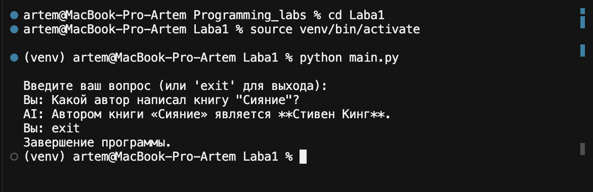
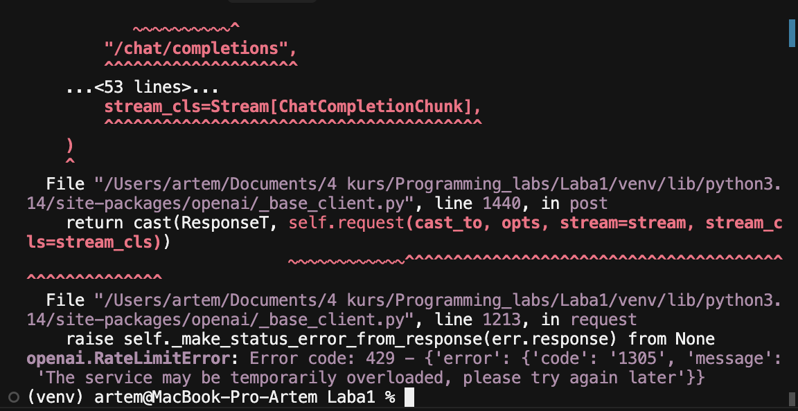
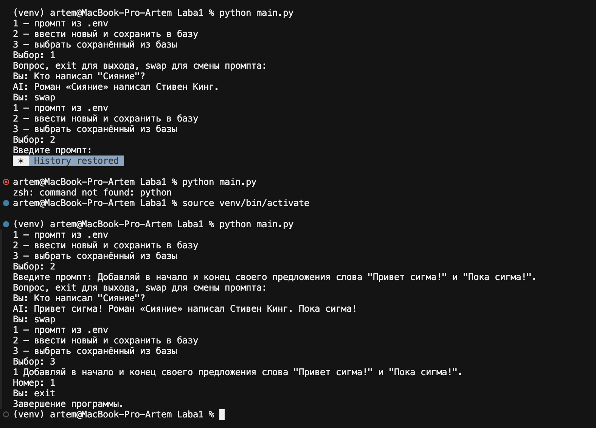
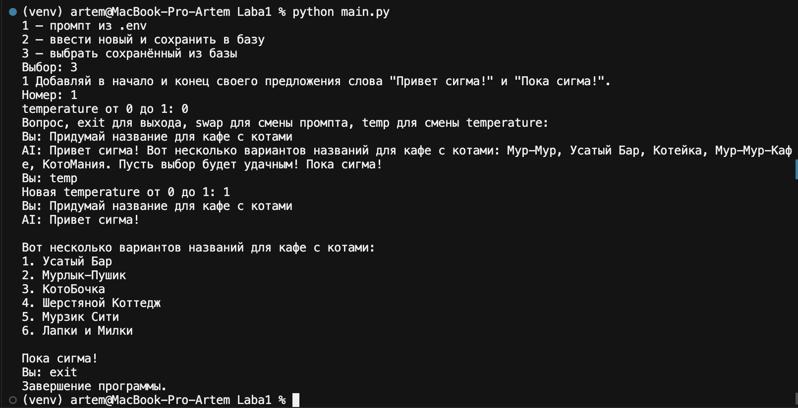
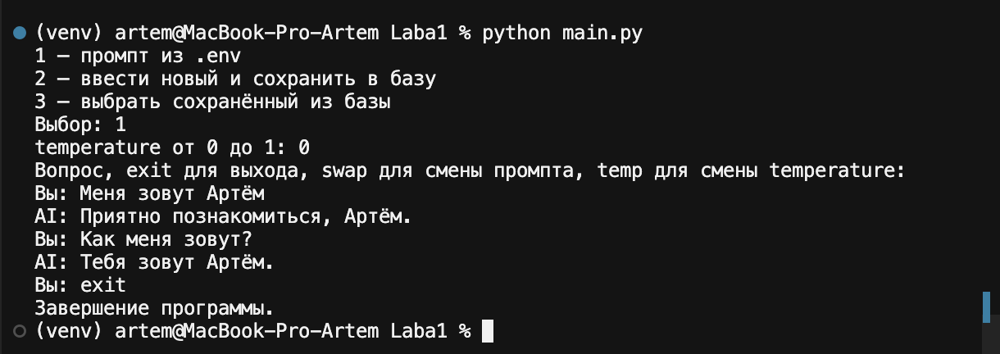

Министерство науки и высшего образования Российской Федерации

Федеральное государственное бюджетное образовательное учреждение высшего образования

«Заполярный государственный университет им. Н. М. Федоровского» (ЗГУ им. Н. М. Федоровского)

Факультет «Электроэнергетики, экономики и управления»

Кафедра «Информационные системы и технологии»

Дисциплина «Технологии программирования»

Отчет к лабораторной работе 0

Тема: «Знакомство с API языковой модели. Написание простого чат-бота»

Студент: Бородин А. С.

Группа: ИС-23

## Содержание

1. Цель и постановка задачи
2. Подготовка окружения
3. Выбор сервиса и модели
4. Базовый диалог
5. Ошибка превышения лимита
6. Системный промпт и его переключение
7. Влияние параметра temperature
8. История диалога
9. Вывод

## 1. Цель и постановка задачи

Цель работы — научиться обращаться к API языковой модели и собрать простого чат-бота, который отвечает на вопросы в терминале.

По методичке требовалось:

1. Поднять виртуальное окружение, установить клиент API и хранить ключ в файле `.env`, не попадающем в репозиторий.
2. Организовать цикл общения: программа принимает вопрос и завершается по команде `exit`.
3. Задать системный промпт двумя способами — из переменной окружения либо ручным вводом с сохранением в базу и последующим выбором — и уметь менять его во время разговора.
4. Проверить, как меняется ответ при изменении параметра генерации, и описать результат.
5. Передавать модели предыдущие реплики, но не больше шести последних: три сообщения пользователя и три ответа модели.

В методичке основной пример построен на OpenAI Responses API и модели `gpt-6-luna`. В обновлённой части той же методички приведён раздел «API с бесплатными моделями»: для учебного диалога допускается другой сервис, если запрос идёт через библиотеку `openai`, а меняются адрес, ключ и имя модели. Эта лабораторная выполнена по этому разделу.

## 2. Подготовка окружения

Работа велась в каталоге `Laba1` на macOS.

Создано виртуальное окружение `venv` и активировано командой `source venv/bin/activate`. После активации в приглашении терминала появляется пометка `(venv)`. Без неё команда `python` в системе не находится: при одном из повторных запусков терминал ответил `command not found: python`. Повторная активация окружения эту ошибку сняла.

Установлены библиотеки `openai` и `python-dotenv`. Список зафиксирован в `requirements.txt`. Ключ доступа записан в `.env`. Файл `.env` внесён в `.gitignore`, чтобы секрет не попал в репозиторий.

Создание ключа само по себе ничего не стоит. Платить пришлось бы только за вызовы платной модели. Карта и баланс ни к одному сервису не привязывались.

## 3. Выбор сервиса и модели

### 3.1. OpenAI

Ключ OpenAI был создан в личном кабинете, однако для лабораторной он не использовался. Запросы к моделям OpenAI списывают деньги с баланса API, а подписка на чат ChatGPT этот баланс не пополняет. По условию работы нужно было обойтись без оплаты.

### 3.2. Groq

Следующим рассматривался Groq. В методичке у него указан бесплатный план без карты и квота, достаточная для учебной работы: 1 000 запросов и 200 000 токенов в сутки. Сайт консоли с этой сети не открылся. Повторная попытка вернула ответ:

`{"error":{"message":"Access denied. Please check your network settings."}}`

Это отказ по сети, а не ошибка ключа. Ключ Groq создать не удалось.

### 3.3. Gemini API

Страница документации Gemini из методички открылась. Страница создания ключа в Google AI Studio тоже открылась, но список моделей не выдала и показала сообщение `Failed to list models: permission denied`. Россия отсутствует в перечне регионов, где Google разрешает AI Studio и Gemini API. Оплата эту блокировку не снимает. Аккаунт чата Gemini к программным запросам не подключается: для кода нужен отдельный ключ API. От этого варианта отказались.

### 3.4. Mistral

Консоль Mistral открылась. Бесплатный режим там есть и карта для него не требуется, но страница входа была на украинском языке («Розпочнімо роботу», «Увійдіть або зареєструйтеся нижче»). Регистрироваться на этой странице не стали.

### 3.5. Z.AI и модель glm-4.7-flash

Остановлены на Z.AI. Это международное имя китайской компании Zhipu AI (юридическое название — Knowledge Atlas Technology, 北京智谱华章科技股份有限公司), штаб-квартира в Пекине. Компания основана в 2019 году, с 8 января 2026 года её акции торгуются на Гонконгской бирже, код 2513. Модели семейства GLM принадлежат ей.

На официальной странице цен у модели GLM-4.7-Flash во всех колонках указано Free: вход, кэш, хранение кэша и выход. Бесплатна именно эта модель. Похожие имена платные: `glm-4.7`, `glm-4.7-flashx`, `glm-5.3-flash`. Платный и подписка Coding Plan. Встроенный поиск по интернету стоит $0,01 за вызов и в работе не использовался.

При регистрации сайт сам создал ключ с именем «默认项目» («проект по умолчанию») и меткой Compatible. У этой строки нет кнопки удаления: сервис не даёт стереть ключ, созданный автоматически. Пока им не пользуются, списаний нет. Для лабораторной создан отдельный ключ на вкладке Standard, имя — `Programming_labs`. При создании спрашивалось только имя. Модель в окне ключа не выбирается: она задаётся позже, в запросе, и во всех опытах это `glm-4.7-flash`. Адрес запросов — `https://api.z.ai/api/paas/v4/`, то есть обычный API, а не адрес Coding Plan.

Отдельного дневного лимита на странице цен нет. При перегрузке сервис отклоняет запрос, а не выставляет счёт.

## 4. Базовый диалог

Первая версия программы спрашивала вопрос в цикле и завершалась по слову `exit`. Проверочный вопрос — об авторе книги «Сияние».

Рисунок 1. Первый успешный диалог.

Модель ответила, что автор книги — Стивен Кинг. Цикл после `exit` корректно завершился. Базовый обмен сообщениями работает.

## 5. Ошибка превышения лимита

Сразу после первого успешного ответа следующий запуск, уже с выбором системного промпта, упал. Программа дошла до запроса, но сервис его не принял.

Рисунок 2. Ошибка RateLimitError.

Текст ошибки: `openai.RateLimitError`, код 429, внутренний код сервиса `1305`, сообщение `The service may be temporarily overloaded, please try again later`. Это ситуация из раздела Troubleshooting методички: лимит или временная перегрузка. Запрос отклонён, деньги за него не списаны. Код из-за этой ошибки не менялся. Повторный запуск примерно через минуту прошёл успешно, что видно по следующим опытам.

## 6. Системный промпт и его переключение

Системный промпт — скрытая инструкция, которая задаёт стиль ответа. В запросе к Z.AI она передаётся сообщением с ролью `system`. Это соответствует бесплатному варианту из методички. В примере на Responses API ту же роль играют параметр `instructions` и сообщение с ролью `developer`.

В терминале три варианта:

1. взять текст из переменной `SYSTEM_PROMPT` в файле `.env`;
2. ввести новый текст и сохранить его в локальную базу `prompts.db`;
3. выбрать уже сохранённый текст по номеру.

Команда `swap` открывает это меню снова, не закрывая программу. Следующий вопрос уходит уже с новым промптом.

В `.env` записана инструкция отвечать по-русски, кратко, одним предложением. Второй промпт введён вручную: добавлять в начало ответа «Привет сигма!», а в конец — «Пока сигма!».

Рисунок 3. Выбор промпта, сохранение в базу и команда swap.

На одном и том же вопросе «Кто написал "Сияние"?» ответы различаются:

| Источник промпта | Ответ |
| --- | --- |
| Пункт 1, текст из `.env` | Роман «Сияние» написал Стивен Кинг. |
| Пункт 2, только что введённый текст | Привет сигма! Роман «Сияние» написал Стивен Кинг. Пока сигма! |

После `swap` и пункта 3 программа показала сохранённую строку под номером 1. Значит, ручной промпт записан в базу и выбирается без повторного ввода. Первый заход в пункт 2 оборвался: сессия терминала восстановилась с пометкой `History restored`, окружение при этом отключилось. Опыт повторён после `source venv/bin/activate`.

## 7. Влияние параметра temperature

У `glm-4.7-flash` нет уровней `reasoning.effort` со значениями `none`, `low`, `medium` и `high`. В методичке они заданы для reasoning-моделей GPT-5 и GPT-6, в том числе для `gpt-6-luna`. Для модели без этого параметра методичка предписывает менять `temperature`. У Z.AI допустимый диапазон — от 0 до 1. Ноль даёт более устойчивую формулировку, единица — более свободную.

Один и тот же вопрос задан дважды: «Придумай название для кафе с котами». Системный промпт в обоих случаях — сохранённый, с «Привет сигма!» и «Пока сигма!». Менялось только значение `temperature`, командой `temp`.

При 0 ответ короче и собран в одно предложение. При 1 модель разбила варианты на список и придумала другие имена. Общая тема сохранилась: кафе и коты. Системный промпт не сбился: оба ответа начинаются с «Привет сигма!» и заканчиваются «Пока сигма!». Отдельный снимок этого прогона не делался, сравнение зафиксировано по выводу терминала.

## 8. История диалога

Чтобы модель помнила разговор, в запрос вместе с новым вопросом подставляются предыдущие реплики. Берётся не больше шести последних: три сообщения пользователя и три ответа модели. Более старые отбрасываются. Системный промпт в эти шесть не входит и отправляется отдельно, в каждом запросе.

Проверка сделана на промпте из `.env` и при `temperature`, равной 0, чтобы стиль не мешал смотреть именно на память.

Рисунок 4. Модель помнит имя из предыдущей реплики.

Сначала отправлено «Меня зовут Артём». Модель ответила: «Приятно познакомиться, Артём». Следующий вопрос имени уже не содержал: «Как меня зовут?». Ответ: «Тебя зовут Артём». Имя взято из предыдущей реплики, а не из самого вопроса.

Перед этим успешным прогоном один запуск выглядел зависшим: после «Меня зовут Артём» ответ долго не появлялся. Был выбран не пункт меню 1, а сохранённый промпт под номером 1 (текст про «сигму»). Запрос ушёл на перегруженный сервис и не вернулся. Процесс остановлен сочетанием `Ctrl+C`. Повтор с пунктом меню 1 прошёл сразу и дал диалог на рисунке 4.

## 9. Вывод

Собран чат-бот на бесплатной модели `glm-4.7-flash` сервиса Z.AI.

Бот отвечает в цикле и завершается по `exit`. Системный промпт берётся из `.env` или из локальной базы, а команда `swap` меняет его в том же сеансе: один и тот же вопрос про автора «Сияния» дал короткий ответ и ответ с обязательными фразами «Привет сигма!» и «Пока сигма!». Параметр `temperature` меняет форму ответа: при 0 названия кафе перечислены абзацем, при 1 — новым списком. История диалога работает: на вопрос «Как меня зовут?» модель ответила именем из предыдущей реплики и не выходит за шесть последних сообщений.

В ходе работы встретились ожидаемые сбои. Сервис один раз вернул ошибку 429 о временной перегрузке; повтор через минуту прошёл. Без активированного окружения команда `python` не находилась.