# ОТЧЁТ ПО ЛАБОРАТОРНОЙ РАБОТЕ № 0

**Дисциплина:** «Технологии программирования»  
**Тема:** «Знакомство с OpenAI API. Написание простого чат-бота»  
**Реализованный вариант:** консольный чат-бот на Python с использованием Groq API и библиотеки `openai`.


## Цель работы

Изучить порядок подготовки Python-проекта и обращения к API большой языковой модели, разработать интерактивного консольного чат-бота и освоить управление его поведением с помощью системных инструкций, параметров генерации и истории сообщений.

## Задачи лабораторной работы

В соответствии с заданием необходимо:

1. Подготовить виртуальное окружение, установить зависимости, получить API-ключ и выполнить первый запрос к модели.
2. Организовать хранение системных инструкций в переменных окружения и реализовать их замену без перезапуска программы (хотсвап).
3. Провести сравнительный эксперимент с параметрами модели. Для выбранной модели `openai/gpt-oss-20b` сравнить `reasoning.effort` при значениях `low`, `medium` и `high`.
4. Организовать контекст диалога: передавать предыдущие реплики с указанием ролей, оставлять в памяти не более шести сообщений (трёх пар «вопрос–ответ») и проверить очистку истории.
5. Зафиксировать результаты работы скриншотами и сформулировать выводы.

## Исходные средства и обоснование выбора

| Средство | Назначение | Причина использования |
|:--|:--|:--|
| Python | Реализация логики программы | Простой синтаксис и удобная интеграция с API |
| VS Code | Создание и редактирование файлов | Встроенный терминал и подсветка синтаксиса |
| `venv` | Изоляция окружения проекта | Библиотеки лабораторной не влияют на другие проекты |
| `openai` | Клиент для HTTP-запросов к модели | Groq предоставляет совместимый API; достаточно указать его `base_url` |
| `python-dotenv` | Чтение настроек из `.env` | Код не содержит секретного ключа и длинных промптов |
| Groq API | Выполнение запросов к языковой модели | API-ключ получен через `console.groq.com` |
| `openai/gpt-oss-20b` | Модель генерации ответов | Поддержка выбранных уровней `reasoning.effort` в используемой конфигурации |

Хотя тема лабораторной содержит название OpenAI API, фактические запросы выполнялись через совместимый интерфейс **Groq**. Это принципиально: ключ Groq не следует передавать на стандартный адрес API OpenAI. Параметр `base_url` позволяет использовать привычные методы клиента с адресом другого поставщика. Набор допустимых параметров при этом определяется поддержкой Groq и выбранной модели.

## 1 Подготовка проекта и получение первого ответа

### 1.1 Создание каталога проекта

Для проекта был создан каталог `lab0_chatbot`. Каталог открывался в VS Code через **File → Open Folder**. Дальнейшие команды выполнялись во встроенном терминале (**Terminal → New Terminal**) из корня проекта. Это важно: пути к `.env` и `main.py` в примерах рассчитаны на запуск из одной папки.

Проверка установленной версии Python:

```powershell
python --version
```

Если команда `python` не обнаруживается, в зависимости от системы может использоваться `py` (Windows) или `python3` (Linux/macOS).

### 1.2 Создание виртуального окружения

```powershell
python -m venv venv
```

Команда создаёт каталог `venv`, содержащий отдельный интерпретатор Python и менеджер пакетов. Активация в Windows PowerShell:

```powershell
.\venv\Scripts\Activate.ps1
```

Для Windows `cmd` используется `venv\Scripts\activate.bat`, для Linux/macOS — `source venv/bin/activate`. Признаком активации служит `(venv)` в начале строки терминала. Окружение необходимо активировать в новом сеансе терминала перед запуском программы.

### 1.3 Установка зависимостей

```powershell
python -m pip install openai python-dotenv
python -m pip freeze > requirements.txt
```

Первая команда устанавливает клиент `openai` и библиотеку `python-dotenv`; вторая сохраняет фактически установленные версии библиотек в `requirements.txt`. Благодаря этому другой пользователь может воспроизвести программное окружение командой:

```powershell
python -m pip install -r requirements.txt
```

### 1.4 Переменные окружения и защита ключа

API-ключ был получен на `https://console.groq.com/` и помещён в файл `.env`. Реальное значение ключа в отчёт не включается. Итоговые настройки имеют следующую структуру:

```dotenv
GROQ_API_KEY=ВАШ_КЛЮЧ_ЗДЕСЬ
MODEL=openai/gpt-oss-20b
SYSTEM_PROMPT=Ты дружелюбный собеседник. Отвечай на вопросы понятно, используя простые слова.
HUMOR_PROMPT=Ты весёлый собеседник с хорошим чувством юмора. Отвечай на вопросы с шутками, иронией и забавными сравнениями.
SHORT_PROMPT=Ты очень лаконичный помощник. Отвечай на любой вопрос максимально кратко, желательно одним предложением.
```

Файл `.gitignore` содержит:

```gitignore
.env
venv/
__pycache__/
*.pyc
```

Назначение `.gitignore` — исключить секретный ключ и временные файлы из последующих коммитов. Библиотека `load_dotenv()` загружает переменные файла `.env` в окружение процесса, после чего `os.getenv()` позволяет считать их из Python-кода.

### 1.5 Базовая версия программы

На первом этапе требовалось добиться ответа модели на одиночный запрос. Минимальная реализация имела следующий вид:

```python
import os
from dotenv import load_dotenv
from openai import OpenAI

load_dotenv()

client = OpenAI(
    api_key=os.getenv("GROQ_API_KEY"),
    base_url="https://api.groq.com/openai/v1"
)

def get_response(text):
    response = client.responses.create(
        model="openai/gpt-oss-20b",
        input=text
    )
    return response.output_text

print("Чат-бот запущен!")
while True:
    question = input("Вы: ")
    if question.lower() == "exit":
        break
    print("AI:", get_response(question))
```

Здесь `OpenAI(...)` создаёт клиента, `client.responses.create(...)` отправляет запрос модели, `input=text` содержит текущий вопрос, а `response.output_text` извлекает текст ответа. Конструкция `while True` обеспечивает непрерывный обмен сообщениями до ввода `exit`.

Запуск из каталога проекта:

```powershell
python main.py
```

Появление ответа на тестовый вопрос подтвердило корректность ключа, настроек адреса API и установки библиотек. На следующем этапе начальная версия была расширена системными инструкциями.

## 2 Задание 1. Системные промпты и переключение режимов

### 2.1 Постановка задания

Необходимо реализовать системный промпт, передаваемый модели параметром `instructions`, и обеспечить его **хотсвап** — изменение без закрытия и повторного запуска чат-бота. В лабораторной допускается хранить промпты в `.env`, поэтому этот способ был выбран как более простой, чем отдельная база данных. База данных при данном варианте не требуется.

### 2.2 Выбор трёх режимов

Для наблюдаемого различия ответов выбраны три инструкции:

- `default` — обычная, понятная и дружелюбная манера общения;
- `humor` — ответ с юмористическими формулировками и сравнениями;
- `short` — максимально краткий ответ, преимущественно одним предложением.


На рисунке 1 показаны переменные с системными инструкциями. Значения `SYSTEM_PROMPT`, `HUMOR_PROMPT` и `SHORT_PROMPT` считываются из `.env` при запуске программы.

<p align="center">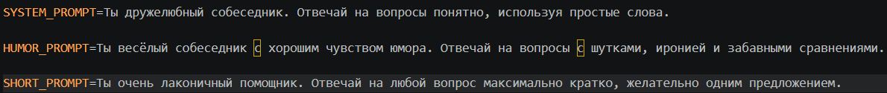</p>
<p align="center"><em>Рисунок 1 – Системные инструкции в файле .env</em></p>

### 2.3 Изменение кода: словарь промптов и активный режим

В `main.py` был добавлен словарь:

```python
prompts = {
    "default": os.getenv("SYSTEM_PROMPT"),
    "humor": os.getenv("HUMOR_PROMPT"),
    "short": os.getenv("SHORT_PROMPT")
}
current_prompt = "default"
```

Словарь связывает короткое имя режима с соответствующей инструкцией. Переменная `current_prompt` хранит ключ активного режима и изначально равна `default`. Преимущество такого решения состоит в том, что для замены поведения модели достаточно изменить значение одной переменной.

В функцию запроса был добавлен аргумент `instructions`:

```python
def get_response(text):
    response = client.responses.create(
        model="openai/gpt-oss-20b",
        instructions=prompts[current_prompt],
        input=text
    )
    return response.output_text
```

Важное отличие от базовой версии: содержимое `instructions` берётся по текущему ключу словаря **в момент каждого запроса**, а не фиксируется один раз при создании клиента.

### 2.4 Изменение кода: команды для хотсвапа

В главный цикл обработки пользовательского ввода добавлены проверки:

```python
elif question == "/default":
    current_prompt = "default"
    print("Обычный режим включён!")
elif question == "/humor":
    current_prompt = "humor"
    print("Режим юмора включён!")
elif question == "/short":
    current_prompt = "short"
    print("Режим кратких ответов включён!")
```

Команды обрабатываются локально программой и **не отправляются** в API как запросы к модели. Обращение к нейросети происходит только в ветви, где пользователь ввёл обычный текст. Таким образом, хотсвап не требует повторного подключения и не расходует API-запрос только ради выбора режима.

После запуска `python main.py` в терминале выводятся доступные команды. На рисунке 2 видно приглашение чат-бота и названия трёх режимов.

<p align="center">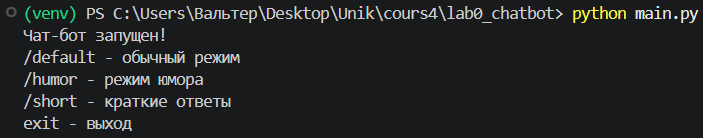</p>
<p align="center"><em>Рисунок 2 – Запуск программы и список команд управления режимами</em></p>

### 2.5 Проверка режима default

Для сравнения использовался один и тот же вопрос: **«Почему люди откладывают дела на потом?»**. Сначала введена команда `/default`, затем вопрос. Как показано на рисунке 3, модель сформировала обычное объяснение причин прокрастинации и предложила практические рекомендации. Такое поведение соответствует исходной инструкции о понятном ответе простыми словами.

<p align="center">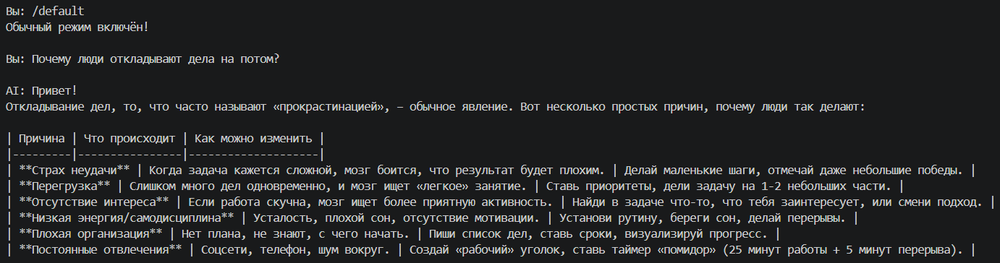</p>
<p align="center"><em>Рисунок 3 – Результат ответа на тестовый вопрос в обычном режиме</em></p>

### 2.6 Проверка режима humor

Далее без завершения программы введена команда `/humor`, после которой повторён тот же вопрос. На рисунке 4 показано, что ответ сохранил смысловую связь с темой прокрастинации, но изменил подачу: появились более разговорные и юмористические формулировки. Различие обусловлено заменой передаваемой системной инструкции, а не изменением вопроса.

<p align="center">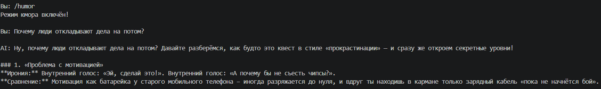</p>
<p align="center"><em>Рисунок 4 – Ответ модели после переключения в юмористический режим</em></p>

### 2.7 Проверка режима short

Третья проверка выполнена после команды `/short`. На рисунке 5 видно, что модель ответила значительно короче, фактически одним предложением. Это позволяет наглядно оценить воздействие системного промпта на объём ответа.

<p align="center">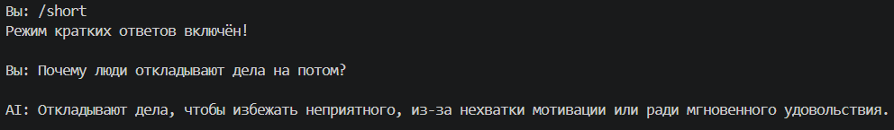</p>
<p align="center"><em>Рисунок 5 – Краткий ответ модели после переключения в режим short</em></p>

### 2.8 Результат первого задания

| Режим | Команда | Наблюдаемый эффект |
|:--|:--|:--|
| Обычный | `/default` | Понятное объяснение с перечислением причин |
| Юмористический | `/humor` | Более неформальная подача с юмором |
| Краткий | `/short` | Существенное сокращение объёма ответа |

**Вывод по заданию 1.** Системные промпты успешно вынесены в переменные окружения и подставляются в `instructions`. Переключение реализовано без перезапуска программы. На скриншотах зафиксированы различные ответы на одинаковый вопрос.

## 3 Задание 2. Исследование влияния reasoning.effort

### 3.1 Постановка задания

Требуется экспериментально сравнить поведение модели при изменении управляющего параметра. Для используемой модели `openai/gpt-oss-20b` через Groq выбран `reasoning.effort` со значениями `low`, `medium`, `high`. В отличие от `temperature`, этот параметр задаёт уровень усилия рассуждения, а не непосредственно степень случайности формулировок. Поэтому для данного проекта `temperature` отдельно не менялся: эксперимент выполнен через поддерживаемый механизм `reasoning.effort`.

### 3.2 Добавление переменной и параметра запроса

После первого задания в программе появилась переменная начального уровня:

```python
reasoning_effort = "medium"
```

В запрос к API добавлен новый аргумент:

```python
response = client.responses.create(
    model="openai/gpt-oss-20b",
    instructions=prompts[current_prompt],
    input=text,
    reasoning={"effort": reasoning_effort}
)
```

Значение переменной считывается при каждом обращении к модели. Установка `medium` по умолчанию позволяет запустить программу без предварительного выбора параметра.

### 3.3 Добавление команды /effort

В обработчик пользовательского ввода добавлено:

```python
elif question == "/effort":
    value = input("Выбери low, medium или high: ").strip().lower()
    if value in ["low", "medium", "high"]:
        reasoning_effort = value
        print("Установлен уровень:", reasoning_effort)
    else:
        print("Неверное значение!")
```

Проверка списка допустимых значений не позволяет случайно отправить в API произвольное слово. Методы `.strip()` и `.lower()` удаляют пробелы по краям и приводят ввод к нижнему регистру. Команда `/effort` так же, как и выбор системных инструкций, исполняется внутри программы, без отдельного запроса к модели.

### 3.4 Подготовка эксперимента

Чтобы сравнение было корректным, во всех испытаниях был выбран **одинаковый системный режим `/default`** и задавался одинаковый вопрос:

> У студента есть 5 часов на подготовку к трём экзаменам. Первый экзамен самый сложный, второй средней сложности, третий лёгкий. Как лучше распределить время подготовки и почему?

Этот вопрос выбран вместо задачи о взвешивании шаров, потому что требует одновременно распределить ограниченное время, учесть приоритеты и объяснить предлагаемое решение. Результат легко сопоставить по критериям: распределение пяти часов, обоснованность решения, наличие перерывов и подробность рассуждений.

**Порядок выполнения:** ввод `/default`, затем `/effort` → `low` → вопрос; затем `/effort` → `medium` → тот же вопрос; затем `/effort` → `high` → тот же вопрос. Результаты не редактировались перед фиксацией на скриншотах.

### 3.5 Эксперимент с low

Рисунок 6 демонстрирует выбор обычного режима и установку значения `low`. Сообщение «Установлен уровень: low» подтверждает, что программа сохранила новое значение управляющей переменной.

<p align="center">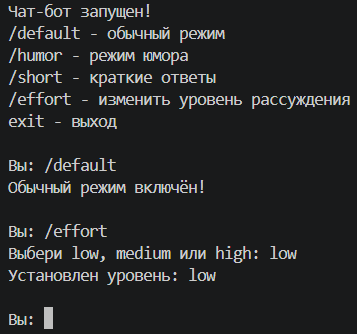</p>
<p align="center"><em>Рисунок 6 – Выбор значения low параметра reasoning.effort</em></p>

Рисунок 7 иллюстрирует ответ на вопрос о распределении времени. Модель предложила краткое распределение часов между тремя экзаменами; ответ можно оценить по конкретности плана. Низкий уровень рассуждения не означает отсутствия корректного решения — он ограничивает выделяемые усилия рассуждения.

<p align="center">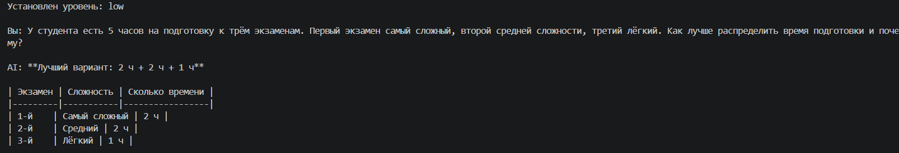</p>
<p align="center"><em>Рисунок 7 – Результат при reasoning.effort = low</em></p>

### 3.6 Эксперимент с medium

После выбора `medium` вопрос был повторён без изменений. На рисунке 8 показано более структурированное объяснение распределения времени: модель рассматривает сложность экзаменов и приводит план подготовки с пояснениями.

<p align="center">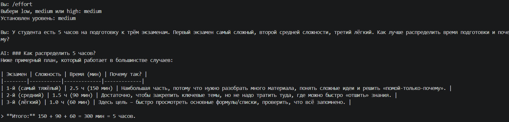</p>
<p align="center"><em>Рисунок 8 – Результат при reasoning.effort = medium</em></p>

### 3.7 Эксперимент с high

В третьем испытании установлен уровень `high`. На рисунке 9 виден более развёрнутый ответ, включающий распределение времени и дополнительные пояснения по выбору приоритетов. Более высокий уровень рассуждения **не гарантирует**, что любой ответ будет точнее или длиннее; в данном опыте оцениваются конкретные зафиксированные ответы.

<p align="center">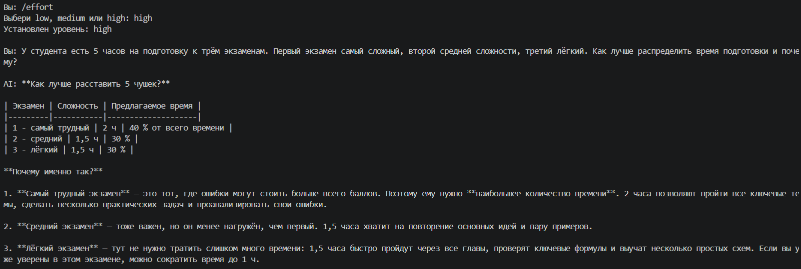</p>
<p align="center"><em>Рисунок 9 – Результат при reasoning.effort = high</em></p>

### 3.8 Анализ результатов второго задания

| Уровень | Характер ответа, наблюдаемый на скриншотах | Критерии сравнения |
|:--|:--|:--|
| `low` | Более компактный план | Указаны ли доли времени для каждого экзамена |
| `medium` | Структурированный план с пояснениями | Обосновано ли распределение по сложности |
| `high` | Более развёрнутые рассуждения и рекомендации | Учтены ли приоритеты и организационные детали |

Ограничение сравнения состоит в том, что для каждого уровня в отчёте приведён один пример ответа. Повторные запуски могут давать отличающиеся формулировки; на основании трёх ответов нельзя делать универсальный вывод о превосходстве одного режима на всех задачах.

**Вывод по заданию 2.** Реализовано изменение `reasoning.effort` без перезапуска программы. Все три поддерживаемых значения были протестированы на одинаковом запросе; полученные ответы различались характером и подробностью пояснений.

## 4 Задание 3. Организация истории диалога

### 4.1 Постановка задания

В базовой версии бот отправлял только текущий вопрос; предыдущие сообщения не попадали в новый запрос, из-за чего модель не могла опираться на предшествующие реплики. Третье задание требует передавать историю в виде списка сообщений, но ограничивать её **шестью последними элементами**: тремя репликами пользователя и тремя ответами ассистента.

### 4.2 Формат истории

В начале программы добавлен пустой список:

```python
history = []
```

Каждый элемент списка — словарь с полями `role` и `content`. Например:

```python
{
    "role": "user",
    "content": "Меня зовут Артём, я учусь на программиста."
}
```

Роль `user` обозначает текст пользователя, роль `assistant` — ответ модели. Сохранение ролей важно: API должен отличать запросы пользователя от ответов ассистента, а не получать произвольный объединённый текст без структуры.

### 4.3 Изменение функции запроса

Вместо одиночной строки `input=text` теперь формируется список сообщений:

```python
messages = history[-6:] + [
    {"role": "user", "content": text}
]

response = client.responses.create(
    model="openai/gpt-oss-20b",
    instructions=prompts[current_prompt],
    input=messages,
    reasoning={"effort": reasoning_effort}
)

answer = response.output_text
history.append({"role": "user", "content": text})
history.append({"role": "assistant", "content": answer})
history = history[-6:]
```

Выражение `history[-6:]` выбирает **шесть последних** сохранённых сообщений. Текущий вопрос добавляется с ролью `user` перед отправкой запроса. После успешного получения ответа в список добавляются текущие вопрос и ответ, а список вновь обрезается до шести элементов.

Таким образом, **в сохранённой истории максимум шесть элементов**, а на этапе отправки очередного запроса в `input` временно может находиться до семи элементов: шесть прошлых и новый вопрос. Это соответствует заданию об ограничении именно истории; новый вопрос не является одной из предыдущих шести реплик.

### 4.4 Добавление команд контроля истории

Для просмотра содержимого добавлена команда `/history`:

```python
elif question == "/history":
    print("\nИстория диалога:")
    if not history:
        print("История пуста.")
    for message in history:
        print(message["role"] + ":", message["content"])
```

Для удаления всех сохранённых сообщений добавлена команда `/clear`:

```python
elif question == "/clear":
    history.clear()
    print("История очищена!")
```

Обе команды выполняются локально. `history.clear()` удаляет элементы существующего списка; после этого следующие запросы не получают прежний контекст переписки.

### 4.5 Проверка памяти контекста

Для проверки сначала введено сообщение с личной информацией учебного характера: **«Меня зовут Артём, я учусь на программиста»**. Затем задан вопрос **«Как меня зовут и на кого я учусь?»**. На рисунке 10 показано, что бот воспроизвёл имя и направление обучения из предыдущей реплики. Следовательно, список сообщений действительно передаётся модели вместе с текущим вопросом.

<p align="center">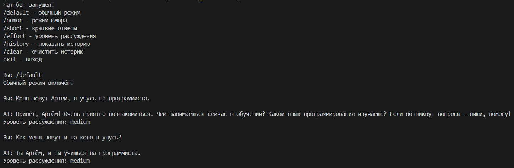</p>
<p align="center"><em>Рисунок 10 – Проверка использования предыдущей реплики при формировании ответа</em></p>

### 4.6 Проверка ограничения шести сообщений

После дополнительной серии вопросов по Python введена команда `/history`. На рисунках 11–13 представлены части вывода списка: вопрос о переменной и последующие вопросы о цикле и функции. Каждая сохранённая пара состоит из элемента `user` и соответствующего элемента `assistant`. В терминале присутствуют три пары, что соответствует заданному пределу в шесть сообщений.

<p align="center">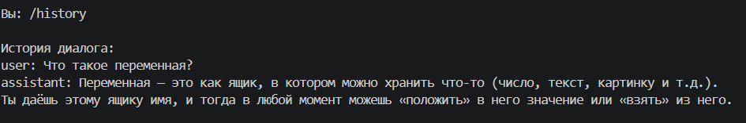</p>
<p align="center"><em>Рисунок 11 – Начало вывода сохранённой истории командой /history</em></p>

<p align="center">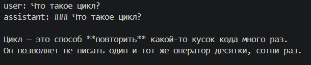</p>
<p align="center"><em>Рисунок 12 – Сохранённая пара сообщений с вопросом о цикле</em></p>

<p align="center">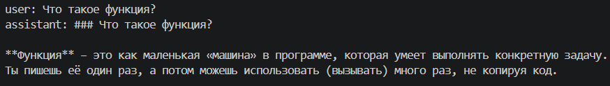</p>
<p align="center"><em>Рисунок 13 – Сохранённая пара сообщений с вопросом о функции</em></p>

### 4.7 Проверка очистки истории

Для завершения проверки выполнена команда `/clear`, затем повторно вызвана `/history`. Результат представлен на рисунке 14: программа вывела подтверждение очистки и сообщение «История пуста». Это подтверждает, что пользователь может сбросить контекст без завершения работы программы.

<p align="center">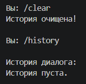</p>
<p align="center"><em>Рисунок 14 – Очистка диалога и подтверждение пустой истории</em></p>

### 4.8 Результат третьего задания

Реализованы накопление, повторная передача, просмотр и очистка диалога. Текущая реализация хранит историю в оперативной памяти работающего процесса. После закрытия программы список исчезает, поскольку сохранение переписки в файл или базу данных в данном варианте не предусмотрено.

## 5 Итоговая структура проекта

```text
lab0_chatbot/
├── .env                # Ключ Groq и системные промпты
├── .gitignore          # Исключаемые из Git файлы
├── main.py             # Программа с тремя заданиями
├── requirements.txt    # Зависимости проекта
└── venv/               # Виртуальное окружение
```

Папка `media/` относится к материалам **данного отчёта** и содержит подтверждающие изображения. Она должна находиться рядом с Markdown-файлом, чтобы относительные ссылки продолжали работать при переносе проекта между компьютерами.


## Заключение

В ходе лабораторной работы создан консольный чат-бот на языке Python, отправляющий запросы к модели `openai/gpt-oss-20b` через совместимый API сервиса Groq. Освоены создание виртуального окружения, установка зависимостей, хранение API-ключа вне исходного кода и формирование запросов через библиотеку `openai`.

В первом задании реализованы три системных промпта и их переключение без перезапуска программы. Во втором задании добавлена настройка `reasoning.effort`; проведено сравнение ответов на идентичный вопрос при трёх уровнях рассуждения. В третьем задании реализована история диалога, ограниченная тремя последними парами сообщений, а также команды просмотра и очистки истории.

Результаты подтверждены четырнадцатью скриншотами. Получены практические навыки изменения поведения языковой модели, организации контекста общения и документирования результатов программного эксперимента.


