# Лабораторная работа № 0

## Знакомство с OpenAI API. Написание простого чат-бота

**Дисциплина:** Технологии программирования  
**Студент:** Остафинский Вадим  
**Группа:** ИС-23  
**Язык программирования:** Python 3.11  
**Провайдер API:** Groq (OpenAI-совместимый интерфейс)  
**Модель:** `openai/gpt-oss-120b`

---

## 1. Цель работы

Цель лабораторной работы — ознакомиться с принципами обращения к большой языковой модели через программный API и разработать консольного чат-бота на Python, который позволяет вести диалог с моделью, настраивать её поведение и управлять передаваемой историей сообщений.

В ходе выполнения работы необходимо:

1. Подготовить репозиторий и локальное окружение Python, установить необходимые библиотеки и обеспечить безопасное хранение API-ключа.
2. Реализовать отправку сообщений языковой модели через OpenAI-совместимый API.
3. Создать несколько системных промптов, хранить их отдельно от кода и обеспечить их замену без перезапуска программы.
4. Организовать хранение истории разговора с ограничением до шести предыдущих сообщений (трёх пар «пользователь — ассистент»).
5. Исследовать влияние параметра усилий рассуждения `reasoning_effort` на ответы модели при уровнях `low`, `medium` и `high`.
6. Провести функциональное тестирование и зафиксировать результаты.

### 1.1. Ожидаемый результат

Результатом должен стать консольный чат-бот, который поддерживает выбор одного из трёх стилей ответа, переключение системного промпта и уровня рассуждения во время работы, сохранение ограниченного контекста беседы, завершение программы по команде.

---

## 2. Использованные технологии и обоснование выбора

Изначально рассматривалось подключение непосредственно к OpenAI API. Однако наличие API-ключа само по себе не означает наличие оплаченной квоты. Для проведения практических экспериментов был выбран провайдер **Groq**, предоставляющий OpenAI-совместимый API.

При этом в Python используется пакет `openai`, но запрос направляется не на серверы OpenAI, а на эндпоинт Groq:

```python
client = OpenAI(
    api_key=api_key,
    base_url="https://api.groq.com/openai/v1"
)
```

Таким образом, в лабораторной изучается формат работы с клиентом OpenAI API, но вычисления выполняет модель `openai/gpt-oss-120b`, доступная через Groq.

### 2.1. Почему используется Chat Completions

Библиотека OpenAI поддерживает разные интерфейсы, включая Responses API. В данной реализации используется **Chat Completions**, поскольку выбранный эндпоинт Groq поддерживает привычный формат списка сообщений `messages`, каждому из которых назначена роль `system`, `user` либо `assistant`.

Вызов имеет вид:

```python
response = client.chat.completions.create(
    model="openai/gpt-oss-120b",
    messages=messages
)
```

Это позволяет реализовать системные инструкции и память диалога простым списком словарей, не добавляя лишних классов и инфраструктуры.

---

## 3. Подготовка репозитория и окружения

### 3.1. Работа с учебным репозиторием

Для хранения лабораторной использовался fork учебного репозитория:

```text
https://github.com/Slavyanin2005/Programming-technologies-2026.git
```

После создания fork репозиторий был клонирован на компьютер. Соответствующие команды имеют вид:

```cmd
git clone https://github.com/Slavyanin2005/Programming-technologies-2026.git
cd Programming-technologies-2026
```

Работа велась в отдельной ветке `lab0` и каталоге:

```text
students/IS/Ostafinskiy Vadim/Laba 0/
```

### 3.2. Проверка Python и создание виртуального окружения

Перед установкой зависимостей проверена доступность Python:

```cmd
py --version
```

Для изоляции пакетов в рабочей папке создано виртуальное окружение:

```cmd
py -m venv venv
```

Его активация в Windows CMD:

```cmd
venv\Scripts\activate
```

После активации в начале приглашения командной строки появляется `(venv)`. Все последующие команды `python` и `pip` выполняются в контексте этого окружения.

<p align="center">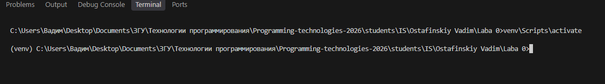</p>
<p align="center"><em>Рисунок 1 — Активированное виртуальное окружение Python в терминале VS Code.</em></p>

### 3.3. Установка библиотек

Для проекта установлены пакеты:

```cmd
pip install openai python-dotenv
```

Назначение пакетов:

- `openai` — отправка запросов и обработка типовых исключений API;
- `python-dotenv` — загрузка переменных окружения из файла `.env`.

Для фиксации установленных зависимостей создан файл `requirements.txt`:

```cmd
pip freeze > requirements.txt
```

При развёртывании проекта на другом компьютере зависимости можно восстановить следующей командой:

```cmd
pip install -r requirements.txt
```

На скриншоте ниже показан этап установки пакетов и связанных зависимостей.

<p align="center">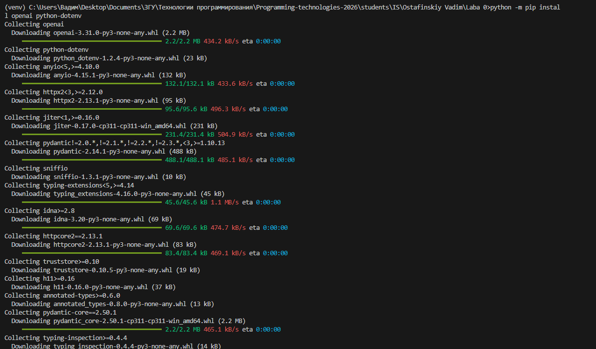</p>
<p align="center"><em>Рисунок 2 — Установка библиотек, необходимых для обращения к API и работы с переменными окружения.</em></p>

### 3.4. Секреты и файл `.env`

На начальном этапе был рассмотрен формат ключа OpenAI, затем рабочее подключение переведено на Groq. Действующий ключ не следует вписывать непосредственно в исходный код и публиковать в Git.

В итоговой конфигурации файл `.env` содержит следующие переменные (вместо значения ключа приведён безопасный шаблон):

```dotenv
GROQ_API_KEY=ваш_личный_ключ_Groq
SYSTEM_PROMPT_HELPER=Ты умный помощник, отвечающий на русском языке.
SYSTEM_PROMPT_PIRATE=Ты пират, который отлично владеет русским языком. Отвечай на вопросы точно, грамотно и понятно. Используй обычные объяснения с уместными и логичными пиратскими сравнениями и метафорами. При этом сохраняй пиратский характер речи: начинай ответ с «Йо-хо-хо!» и иногда обращайся к пользователю «капитан» или «дружище». Не жертвуй точностью ответа ради пиратского стиля.
SYSTEM_PROMPT_JSON=Отвечай исключительно в формате JSON-объекта с двумя строковыми полями "question" и "answer". В поле "question" повторяй вопрос пользователя, а в поле "answer" давай ответ на русском языке. Не добавляй пояснений и Markdown.
```

На рисунке 3 зафиксирован **ранний этап настройки** `.env`; итоговая версия использует `GROQ_API_KEY` и три переменные `SYSTEM_PROMPT_*`.

<p align="center">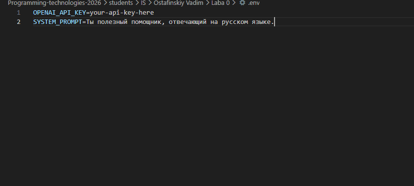</p>
<p align="center"><em>Рисунок 3 — Первоначальная конфигурация переменных окружения; позднее подключение заменено на Groq.</em></p>

В программе используется:

```python
from dotenv import load_dotenv
import os

load_dotenv()
api_key = os.getenv("GROQ_API_KEY")
```

`load_dotenv()` загружает переменные из `.env`, а `os.getenv()` получает их значения. Это позволяет изменять ключ и тексты системных промптов без правки Python-файла.

### 3.5. Исключение секретов из Git

В корне рабочей папки лабораторной добавлен `.gitignore`:

```gitignore
venv/
.env
__pycache__/
*.pyc
```

Пояснение:

- `venv/` — виртуальное окружение со сторонними библиотеками, которое можно восстановить;
- `.env` — закрытый файл с реальным API-ключом;
- `__pycache__/` и `*.pyc` — генерируемые Python служебные файлы.

Проверить, что секретные файлы не попадают в новые неотслеживаемые изменения, можно командой:

```cmd
git status --short --untracked-files=all
```

---

## 4. Разработка чат-бота

### 4.1. Первый вариант: запрос к модели

Разработка началась с реализации базового обращения к языковой модели через API. Программа получала вопрос пользователя из консоли, формировала запрос к модели openai/gpt-oss-120b и выводила полученный ответ. На данном этапе история диалога и переключение системных промптов ещё не были реализованы.

```python
client = OpenAI(
    api_key=api_key,
    base_url="https://api.groq.com/openai/v1"
)

question = input("Вы: ")

response = client.chat.completions.create(
    model="openai/gpt-oss-120b",
    messages=[
        {"role": "user", "content": question}
    ]
)

print("AI:", response.choices[0].message.content)
```

В структуре ответа `choices[0].message.content` находится текст выбранного ответа ассистента. Позднее этот алгоритм был вынесен в функцию `get_response()`.

На рисунке 4 представлен один из промежуточных вариантов исходного кода. Он отличается от окончательной версии: в дальнейшем добавились история, выбор промпта и уровень рассуждения.

<p align="center">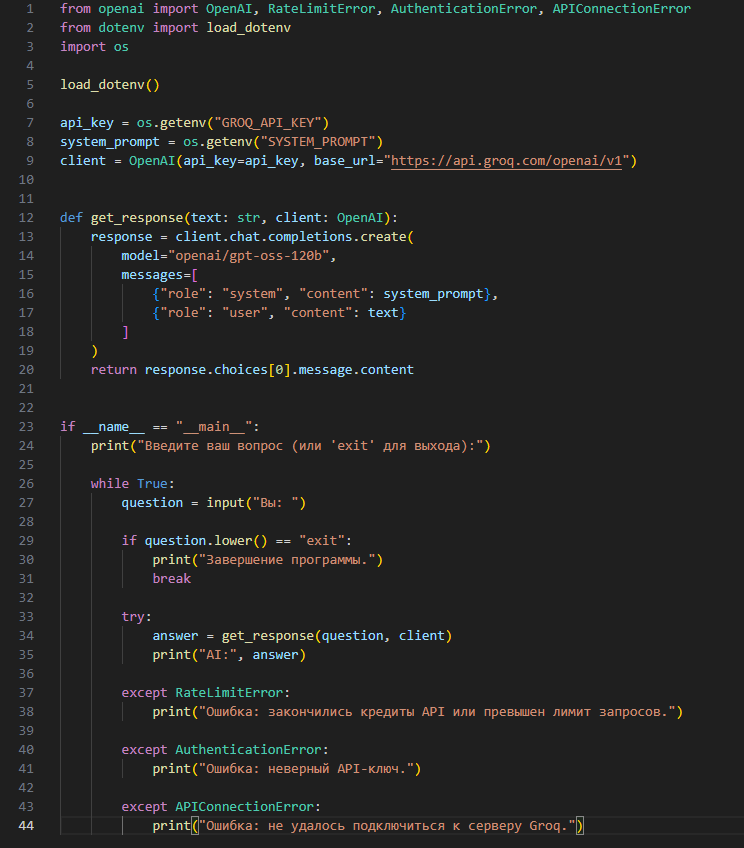</p>
<p align="center"><em>Рисунок 4 — Промежуточная реализация чат-бота в Visual Studio Code.</em></p>

### 4.2. Проверка подключения

Для запуска из каталога лабораторной использовалась команда:

```cmd
python main.py
```

При первом успешном обращении бот ответил на вопрос о языке Python. Это подтвердило корректность установленного пакета, настроенного endpoint, рабочего ключа и обработки результата API.

<p align="center">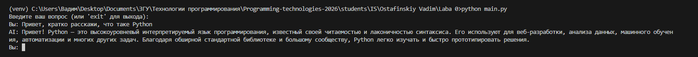</p>
<p align="center"><em>Рисунок 5 — Первый успешный ответ модели в консоли.</em></p>

### 4.3. Доработки

Однократный вызов API ещё не является полноценным чат-ботом: пользователь должен иметь возможность отправлять несколько вопросов без перезапуска программы. Поэтому логика работы была помещена в цикл `while True`, в котором:

1. Программа ожидает ввод `input("\nВы: ")`.
2. Проверяет служебные команды.
3. Пропускает пустую строку.
4. Отправляет пользовательский вопрос модели.
5. Печатает ответ с префиксом `AI:`.
6. После успешного запроса обновляет историю сообщений.

Команда `exit` завершает цикл с помощью `break`. Исключения API перехватываются отдельно, чтобы известная сетевая или авторизационная ошибка не приводила к непонятному выводу трассировки.

---

## 5. Системные промпты и переключение поведения

### 5.1. Понятие системного промпта

**Системный промпт** — инструкция, задающая общие правила поведения ассистента: язык ответа, стиль, форму результата и другие условия. В отличие от обычного вопроса пользователя он передаётся с ролью `system`.

В Chat Completions сообщение представлено словарём:

```python
{"role": "system", "content": system_prompt}
```

В лабораторной предусмотрены три варианта:

| Номер | Роль | Требуемое поведение |
|---|---|---|
| `1` | Обычный помощник | Понятные ответы на русском языке |
| `2` | Пират | Сохранение фактической точности при характерном пиратском стиле |
| `3` | JSON-бот | Ответ строго как JSON-объект с полями `question` и `answer` |

Такая конфигурация позволяет увидеть, как одна и та же модель меняет поведение под действием разных системных инструкций.

### 5.2. Загрузка нескольких промптов из `.env`

Тексты считываются в словарь:

```python
prompts = {
    "1": os.getenv("SYSTEM_PROMPT_HELPER"),
    "2": os.getenv("SYSTEM_PROMPT_PIRATE"),
    "3": os.getenv("SYSTEM_PROMPT_JSON")
}
```

Ключи словаря совпадают с пунктами меню.

<p align="center">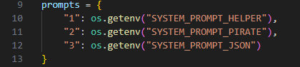</p>
<p align="center"><em>Рисунок 6 — Словарь для чтения трёх системных промптов из переменных окружения.</em></p>

### 5.3. Реализация горячего переключения (hot swap)

Для выбора используется функция `choose_prompt()`. Она показывает меню, считывает пункт и проверяет:

- входит ли номер в доступные варианты;
- задан ли текст выбранного промпта в `.env`.

Если номер неверный либо значение отсутствует, выбор повторяется.

Во время диалога специальная команда `/prompt` вызывает эту функцию повторно:

```python
if question.lower() == "/prompt":
    system_prompt = choose_prompt()
    history.clear()
    print("История диалога очищена.")
    continue
```

Таким образом, программа не перезапускается, но очередные запросы используют уже другое системное сообщение. После смены роли история очищается, чтобы вопросы и ответы предыдущего режима не влияли на новый эксперимент. Код ожидает именно отдельную команду `/prompt`, а затем ввод номера в меню.

### 5.4. Эксперименты с тремя ролями

Для проверки задавался содержательно одинаковый вопрос о Python. Были получены ответы обычного помощника, пиратского персонажа и JSON-бота. При первичной проверке пиратского варианта стиль оказался недостаточно естественным. Поэтому текст `SYSTEM_PROMPT_PIRATE` был уточнён: добавлены требования сохранять точность, начинать с «Йо-хо-хо!» и использовать уместные морские сравнения. Повторный тест продемонстрировал более последовательное соответствие выбранному персонажу.

<p align="center">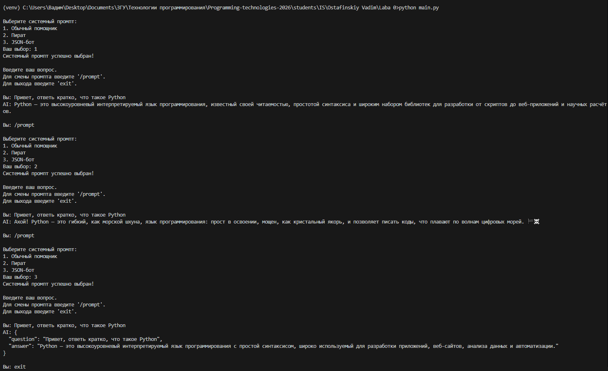</p>
<p align="center"><em>Рисунок 7 — Проверка переключения системных промптов и различий в ответах модели.</em></p>

<p align="center">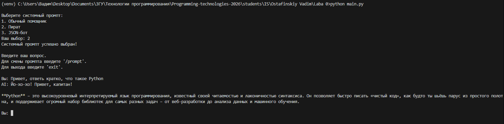</p>
<p align="center"><em>Рисунок 8 — Повторная проверка пиратского промпта после уточнения инструкций.</em></p>

**Вывод:** системные промпты успешно задают разные стили и форматы ответа, а команда `/prompt` позволяет переключать их в процессе работы без изменения кода.

---

## 6. Реализация и проверка истории диалога

### 6.1. Почему один пользовательский вопрос не обеспечивает память

Запросы Chat Completions независимы: API не обязан самостоятельно хранить предыдущие сообщения локальной программы. Если отправить только текущий текст, бот не сможет надёжно ответить на вопросы вида «Как меня зовут?» после представления пользователя.

Поэтому в программе создан список:

```python
history = []
```

После каждого **успешного** ответа в него добавляются два сообщения:

```python
history.append({"role": "user", "content": question})
history.append({"role": "assistant", "content": answer})
```

При новом запросе сначала формируется системное сообщение, затем добавляется прежняя история и только после неё — текущий вопрос:

```python
messages = [
    {"role": "system", "content": system_prompt}
]
messages.extend(history)
messages.append({"role": "user", "content": text})
```

Именно этот список передаётся в `client.chat.completions.create()`.

### 6.2. Ограничение истории шестью сообщениями

Согласно заданию, программа сохраняет только последние шесть сообщений диалога — три вопроса пользователя и три ответа модели.

Для этого после добавления новой пары выполняется:

```python
history = history[-6:]
```

Срез `[-6:]` создаёт список из шести последних элементов. Пока сообщений меньше шести, остаются все имеющиеся. Когда накапливается восемь, первые два автоматически отбрасываются.

Важно различать **хранимую историю** и **список текущего API-запроса**. В реализации `history` после каждого ответа содержит не более шести прошлых реплик. При следующем запросе к этим шести репликам временно добавляется новый вопрос, поэтому передаваемый модели список может включать семь сообщений диалога и одно системное. Это осознанная трактовка требования как ограничения сохраняемой истории: сохраняются три последние законченные пары «вопрос — ответ».

### 6.3. Проверка запоминания имени

Проверка производилась последовательно:

```text
Вы: Привет, меня зовут Вадим
AI: Привет, Вадим! Рад знакомству. Чем могу помочь?

Вы: Напомни, как меня зовут?
AI: Твоё имя — Вадим.
```

Правильный ответ на второй вопрос указывает, что сведения из предыдущей реплики переданы в контекст модели.

### 6.4. Проверка очистки истории при смене промпта

Далее выполнено переключение с обычного помощника на JSON-бота. Затем имя снова сообщено модели, и при повторном вопросе она правильно его воспроизвела. Следовательно, переключение промпта очищает старый контекст, но не мешает созданию новой истории.

<p align="center">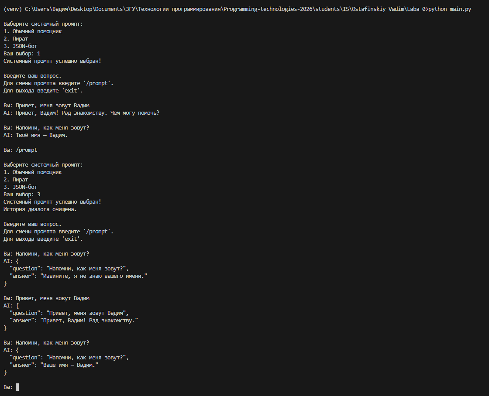</p>
<p align="center"><em>Рисунок 9 — Проверка очистки старого контекста при переключении на JSON-бота.</em></p>

### 6.5. Эксперимент с вытеснением старых сообщений

Для проверки обрезки истории выполнена серия из пяти пользовательских сообщений:

| № | Сообщение пользователя | Ответ модели |
|---|---|---|
| 1 | «Запомни секретное слово: апельсин. Ответь только „Запомнил“.» | «Запомнил.» |
| 2 | «Сколько будет 2 + 2?» | «4.» |
| 3 | «Сколько будет 3 + 3?» | «6.» |
| 4 | «Сколько будет 4 + 4?» | «8.» |
| 5 | «Какое секретное слово я попросил запомнить в начале разговора? Если не знаешь, так и скажи.» | «Я не знаю, какое слово вы имели в виду.» |

После четвёртой пары в истории сохраняются только вопросы и ответы 2–4. Слово «апельсин» содержалось в первой паре, которая была вытеснена. При обработке пятого вопроса модель уже не получила это слово через `history`.

<p align="center">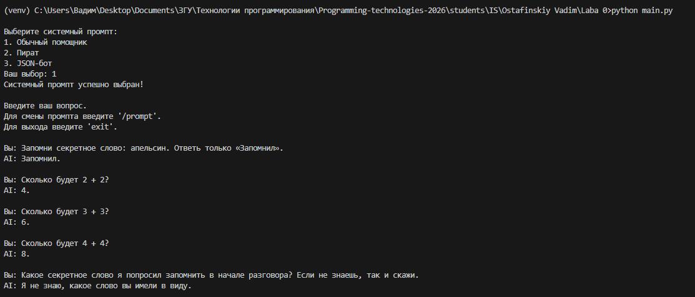</p>
<p align="center"><em>Рисунок 10 — Тест вытеснения первой пары сообщений после накопления трёх более поздних пар.</em></p>

**Результат:** модель сообщила, что не знает секретного слова. Это согласуется с ожидаемым действием алгоритма. При этом ответ модели — наблюдение, а **формальную гарантию ограничения списка** даёт именно срез `history[-6:]`. Языковая модель теоретически может случайно угадать ранее использованное слово; такое совпадение не означало бы, что список не очищен.

---

## 7. Эксперименты с `reasoning_effort`

### 7.1. Суть параметра

Параметр `reasoning_effort` задаёт уровень вычислительных усилий, выделяемых моделью на внутреннюю обработку задачи. Он не является прямой настройкой количества слов в итоговом ответе.

В методических указаниях для reasoning-моделей рассматриваются уровни `none`, `low`, `medium` и `high`. Для выбранного подключения `openai/gpt-oss-120b` через Groq в данной работе использованы поддерживаемые значения:

- `low` — низкий уровень усилий;
- `medium` — средний;
- `high` — высокий.

Уровень `none` не включён в меню выбранной конфигурации, так как он не поддерживается применяемым вариантом модели через Groq. Поэтому эксперимент охватывает три уровня, а не четыре. Параметр `temperature` в методических указаниях выделен главным образом для более старых моделей без reasoning; в этой работе он не изменялся.

### 7.2. Изменение исходного кода

Чтобы пользователь мог выбрать уровень перед началом беседы, добавлена функция `choose_reasoning()`:

```python
def choose_reasoning():
    print("\nВыберите уровень рассуждения:")
    print("1. low")
    print("2. medium")
    print("3. high")

    levels = {"1": "low", "2": "medium", "3": "high"}

    while True:
        choice = input("Ваш выбор: ").strip()
        if choice in levels:
            print("Уровень reasoning:", levels[choice])
            return levels[choice]
        print("Неверный выбор. Попробуйте снова.")
```

Выбранное значение передаётся в функцию `get_response()` и далее непосредственно в запрос:

```python
response = client.chat.completions.create(
    model="openai/gpt-oss-120b",
    messages=messages,
    extra_body={"reasoning_effort": reasoning_effort}
)
```

Здесь `extra_body` позволяет добавить параметр провайдера к запросу через OpenAI SDK.

Для переключения уровня добавлена отдельная команда:

```python
if question.lower() == "/reasoning":
    reasoning_effort = choose_reasoning()
    history.clear()
    print("История диалога очищена.")
    continue
```

При каждом переходе к новому уровню `history.clear()` удаляет предыдущие ответы: без этого результаты эксперимента зависели бы не только от `reasoning_effort`, но и от уже накопленного контекста.

### 7.3. Выбор задания для сравнения

Первоначально проверялась короткая математическая задача про яблоки. Модель правильно получила ответ (**6 яблок у Пети и 12 у Маши**), но оформила формулы в LaTeX, который в обычной CMD-консоли выводился исходными символами `\(`, `\[` и т. п. Для более наглядного качественного сравнения был выбран текстовый вопрос без формул:

> Почему при разработке программ важно не только написать работающий код, но и сделать его понятным для других разработчиков? Приведи три аргумента.

Этот вопрос требует аргументации, а не арифметики; в нём можно сопоставить полноту, структуру и содержательность ответов.

**Контролируемые условия эксперимента:**

1. Во всех трёх запусках использовалась модель `openai/gpt-oss-120b`.
2. Системный промпт не изменялся: выбран обычный помощник.
3. Текст пользовательского вопроса оставался идентичным.
4. Перед новым уровнем история очищалась командой `/reasoning`.
5. Изменялось только значение `reasoning_effort`.

Время ответа программно не измерялось, поэтому сравнение скорости на основании этих опытов не проводится.

### 7.4. Эксперимент № 1: уровень `low`

Последовательность: выбрать системный промпт `1`, затем уровень `1` (`low`), после чего отправить контрольный вопрос.

Модель привела три аргумента. Ответ был понятен, содержал объяснения и примеры, полностью соответствовал поставленной задаче. Несмотря на минимальный из выбранных уровней reasoning, качество ответа оказалось достаточным для простого теоретического вопроса.

<p align="center">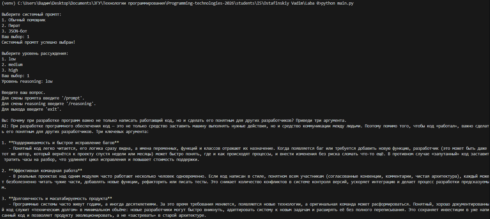</p>
<p align="center"><em>Рисунок 11 — Ответ модели при <code>reasoning_effort="low"</code>.</em></p>

### 7.5. Эксперимент № 2: уровень `medium`

Без перезапуска программы введена команда `/reasoning`, после чего выбран пункт `2` (`medium`). История была очищена, и задан тот же вопрос.

Модель снова выделила три содержательных аспекта. В отличие от первого опыта ответ был оформлен **таблицей**, дополненной итоговым выводом и рекомендациями по практике написания понятного кода.

Содержательные различия оказались умеренными, однако заметно изменился способ подачи материала.

<p align="center">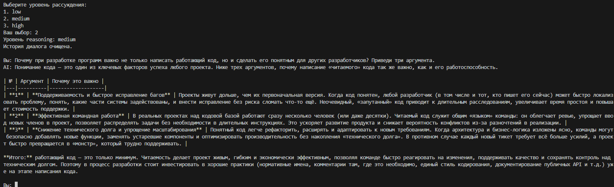</p>
<p align="center"><em>Рисунок 12 — Ответ модели при <code>reasoning_effort="medium"</code>.</em></p>

### 7.6. Эксперимент № 3: уровень `high`

Снова выполнена команда `/reasoning`, на этот раз выбран пункт `3` (`high`). После очистки истории повторён контрольный вопрос.

Ответ получился наиболее развёрнутым. Каждый из трёх аргументов содержал несколько поясняющих подпунктов. В конце появилась дополнительная сводная таблица.

При этом модель привела процентную оценку затрат на сопровождение ПО со ссылкой лишь на названия компаний без конкретного проверяемого исследования. Эту статистику нельзя считать подтверждённым фактом только на основании ответа модели. Это подчёркивает, что большой уровень reasoning сам по себе не гарантирует достоверность каждого дополнительного утверждения.

<p align="center">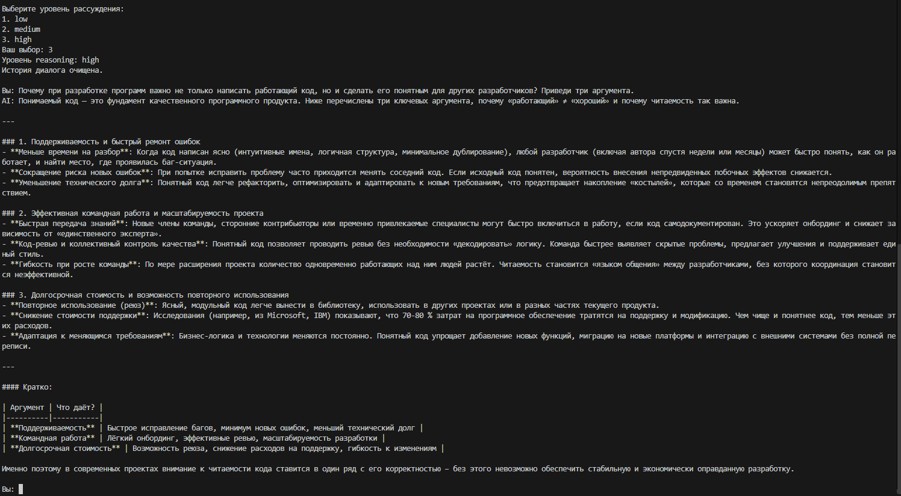</p>
<p align="center"><em>Рисунок 13 — Ответ модели при <code>reasoning_effort="high"</code>.</em></p>

### 7.7. Сравнительная таблица

| Критерий | `low` | `medium` | `high` |
|---|---|---|---|
| Выполнение запроса на три аргумента | Выполнено | Выполнено | Выполнено |
| Основные идеи | Сопровождение, команда, развитие продукта | Сходные идеи с упором на техдолг | Сходные идеи с расширенными примерами |
| Структура | Нумерованный список | Сравнительная таблица и вывод | Подразделы, подпункты, итоговая таблица |
| Наблюдаемая детализация | Умеренная | Умеренная | Наиболее высокая |
| Особенности | Достаточная информативность при низком уровне | Удобная табличная подача | Больше контекста; появилось неподтверждённое числовое утверждение |

**Вывод по эксперименту:** все три уровня дали релевантный ответ. На конкретном вопросе `high` проявился прежде всего в большей детализации, а `medium` — в ином оформлении. Для однозначного вывода о превосходстве какого-либо уровня недостаточно одного вопроса и одного ответа на уровень. Выбор `reasoning_effort` целесообразно связывать со сложностью задачи, а не только с желаемым объёмом текста.

---

## 8. Общие выводы

В ходе лабораторной работы был разработан консольный чат-бот на Python с использованием OpenAI-совместимого API провайдера Groq и модели `openai/gpt-oss-120b`. Были освоены принципы взаимодействия с языковой моделью через API, настройки программного окружения и безопасного хранения API-ключа.

В программе реализованы три системных промпта с возможностью переключения без перезапуска, сохранение истории диалога с ограничением до шести последних сообщений и настройка уровня рассуждения модели. Проведённые испытания подтвердили корректную работу переключения промптов, запоминания контекста и удаления устаревших сообщений. Эксперименты с `reasoning_effort` показали различия в подробности и структуре ответов при уровнях `low`, `medium` и `high`.

Таким образом, **цель лабораторной работы достигнута**. Получен практический опыт разработки чат-бота и установлено, что на поведение языковой модели влияют системные инструкции, передаваемая история диалога и параметры API-запроса.

---
