# Лабораторная работа №2
## Разработка API-сервиса структурирования текстовых данных с использованием локальной LLM

**Вариант 2 — обработка запросов в библиотеке.**

**Цель работы:** создать API-сервис, который принимает сообщения читателей, извлекает из них данные с помощью локальной языковой модели, проверяет результат и сохраняет его в PostgreSQL.

## 1. Выбор предметной области

По варианту я разрабатывала сервис для регистрации обращений читателей библиотеки. Например, читатель может попросить выдать или продлить книгу, узнать о её наличии либо задать другой вопрос. Программа **не выдаёт книги на самом деле** и не меняет их наличие — только фиксирует обращение.

## 2. Общие задания

### 2.1. Разработка сервиса и базы данных

Для работы я выбрала **Python и FastAPI**. Данные хранятся в **PostgreSQL**, взаимодействие с базой организовано через **SQLAlchemy**. Текст обрабатывает локальная модель семейства **Qwen2.5** через **LM Studio** и библиотеку `openai`. Для проверки полученного JSON используется **Pydantic**. Последние эксперименты проводились с `qwen2.5-vl-3b-instruct`.

**Структура проекта:**

```text
Лабораторная_2/
├── .venv/             — виртуальное окружение Python
├── __pycache__/       — служебный кэш Python
├── images/            — скриншоты для отчёта
├── .env               — параметры подключения к БД и LM Studio
├── .gitignore         — исключения для Git
├── database.py        — подключение к PostgreSQL и сессии
├── models.py          — описание таблиц SQLAlchemy
├── schemas.py         — проверка входных и извлечённых данных
├── llm.py             — системная инструкция и вызов Qwen
├── main.py            — маршруты и обработка запросов FastAPI
├── seed.py            — создание таблиц и заполнение каталога
├── requirements.txt   — библиотеки Python
└── README.md          — описание и результаты работы
```

В базе созданы две таблицы: `books` — справочник изданий с ID, уникальным кодом и названием; `library_requests` — сохранённые обращения с исходным текстом, датой, извлечёнными полями, ссылкой на книгу (если она найдена) и результатом сопоставления. Через `seed.py` я добавила пять книг: «Лето в пионерском галстуке», «Всё закончится на нас», «Шестёрка воронов», «Четвёртое крыло», «Гипотеза любви».

Параметры БД и модели хранятся в `.env`, а сам файл исключён из Git с помощью `.gitignore`. PostgreSQL запускался в Docker, FastAPI и LM Studio — локально.

### 2.2. Настройка извлечения данных

В файле `llm.py` я составила системную инструкцию: модель должна **разобрать обращение, а не отвечать читателю**. Сам текст передаётся отдельно от инструкции. Модель должна вернуть JSON **ровно с шестью полями**:

| Поле | Что содержит |
|---|---|
| `category` | Тип обращения: `borrow`, `renew`, `availability` или `other` |
| `summary` | Краткий смысл обращения |
| `book_code` | Код книги, если читатель его указал |
| `reader_card` | Номер читательского билета |
| `requested_period` | Запрошенная дата или срок |
| `details` | Другие сведения из самого сообщения |

Если каких-то данных нет, модель должна ставить `null`, а не придумывать их. Даты и сроки не нужно переводить в другой формат. Для более стабильного JSON использовалась схема извлечения данных.

### 2.3. Проверка результата и сопоставление со справочником

После ответа Qwen программа разбирает JSON и проверяет его через Pydantic: правильность полей и типов, разрешённую категорию, обязательное краткое описание и отсутствие лишних ключей. Если формат неверный, обращение не должно сохраняться.

Затем SQLAlchemy ищет книгу по извлечённому коду. Используются три статуса:

- `matched` — книга с таким кодом найдена;
- `not_found` — код указан, но книги нет в каталоге;
- `not_provided` — читатель не указал код.

Если книга отсутствует, обращение всё равно сохраняется, но без связи с записью справочника. **Новые книги на основании ответа модели автоматически не создаются.**

### 2.4. Создание API

В `main.py` я реализовала три маршрута:

| Метод | Адрес | Назначение |
|---|---|---|
| `POST` | `/library-requests` | Обработать и сохранить новое обращение |
| `GET` | `/library-requests` | Получить список обращений |
| `GET` | `/library-requests/{request_id}` | Получить запись по её ID |

Для запуска использовала `python -m uvicorn main:app --reload`, а запросы выполняла через Swagger UI (`http://127.0.0.1:8000/docs`). Отдельный интерфейс для лабораторной не понадобился.

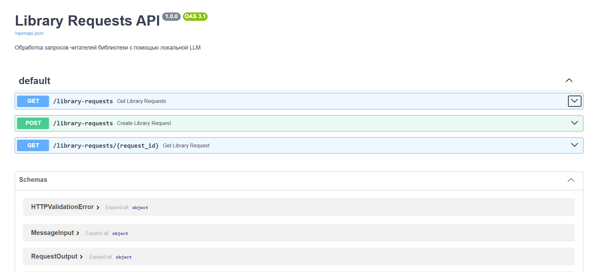

*Рисунок 1 — Методы разработанного API в Swagger.*

## 3. Индивидуальное задание: библиотека

По своему варианту я настроила четыре категории обращений: `borrow` (взять книгу), `renew` (продлить), `availability` (узнать о наличии), `other` (другой вопрос). Дополнительные поля — номер читательского билета и запрашиваемый период. Если в обращении есть только название книги, но нет каталожного кода, `book_code` должен остаться `null`. Это важно, чтобы нейросеть не приписывала читателю код, которого он не указывал.

## 4. Проверка работы

### 4.1. Пять основных сценариев

**1. Полное сообщение с существующим кодом.** Я попросила продлить книгу `BK-118` ещё на неделю и указала билет `R-302`. Сервер вернул `201`, категория `renew` и связь с книгой (`matched`). Однако модель изменила фразу «ещё на неделю» на `7 days` — структура правильная, но срок извлечён неточно.

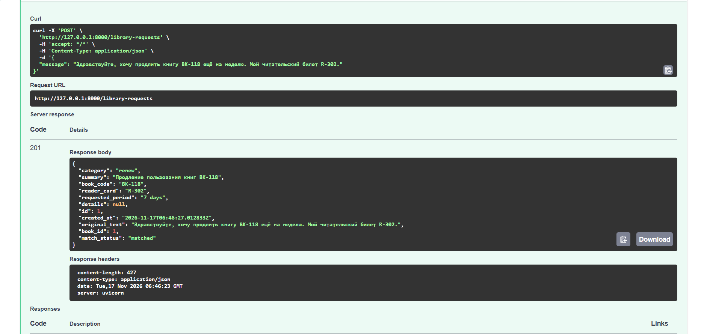

*Рисунок 2 — Продление книги с существующим кодом.*

**2. Сообщение без кода и дополнительных данных.** Вопрос о наличии книги «Четвёртое крыло» не содержал каталожного кода и номера билета. Сервер вернул `201`, категорию `availability`, статус `not_provided`, а отсутствующие значения оставил `null`.

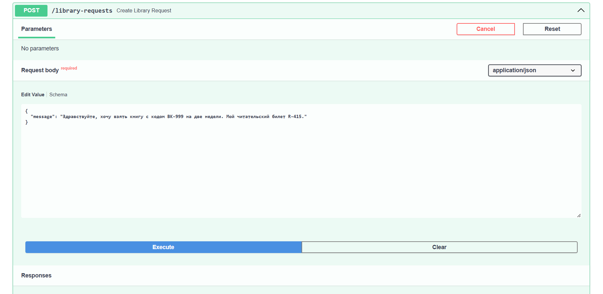

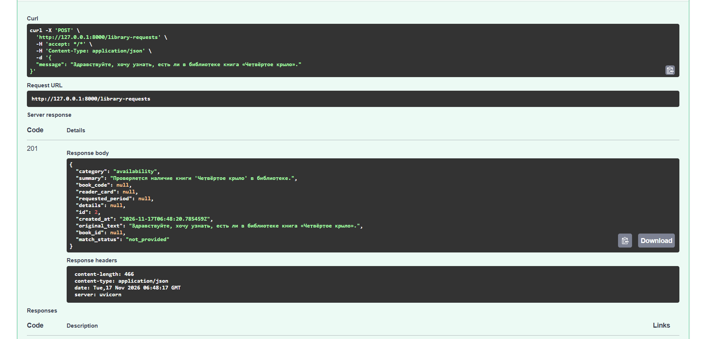

*Рисунки 3–4 — Запрос по названию книги без каталожного кода.*

**3. Неизвестный код.** Я отправила запрос на книгу `BK-999` с билетом `R-415`. Такой книги нет в справочнике. Обращение сохранилось с кодом `201`, значением `book_id: null` и статусом `not_found`.

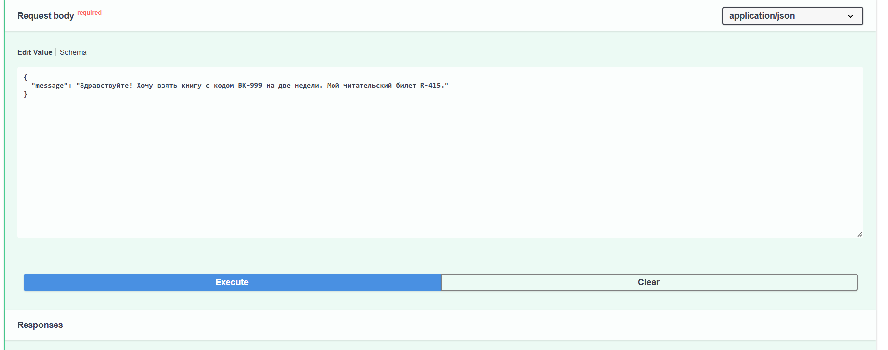

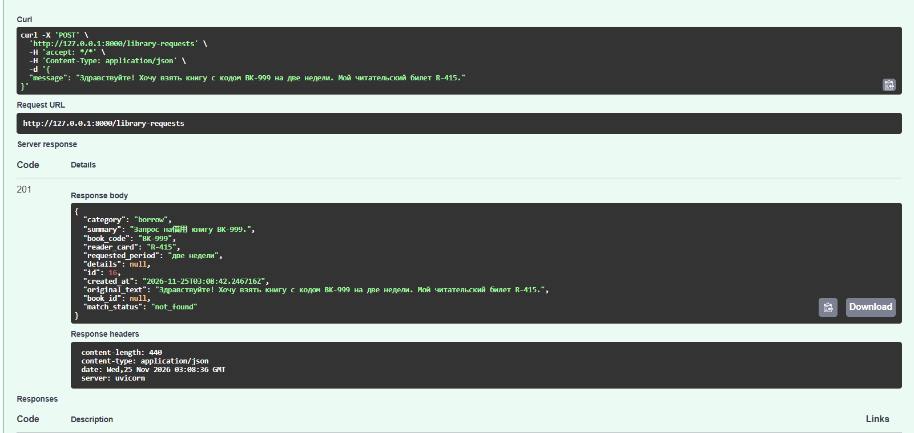

*Рисунки 5–6 — Сохранение обращения с неизвестным кодом.*

**4. Другая категория.** В вопросе о наличии книги `BK-407` модель определила `availability`. База нашла книгу с `book_id: 4`, и сервис вернул `matched` и код `201`. Поля без исходных сведений остались `null`.

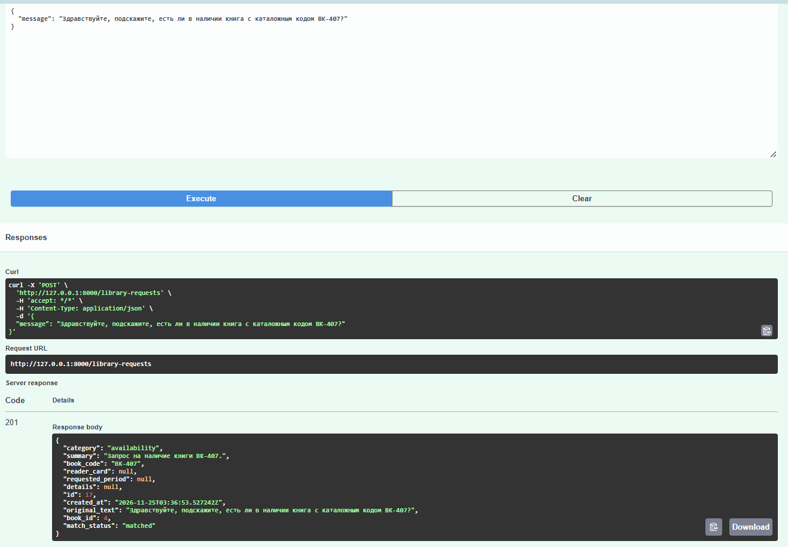

*Рисунок 7 — Проверка другой категории и сопоставление с существующей книгой.*

**5. Категория `other`.** На вопрос «Где находится читальный зал библиотеки?» модель **не придумала расположение** и вернула `details: null`. Но допустила другую ошибку: указала категорию `availability` вместо ожидаемой `other`. Поэтому этот сценарий по смыслу отработал не полностью, несмотря на ответ `201`.

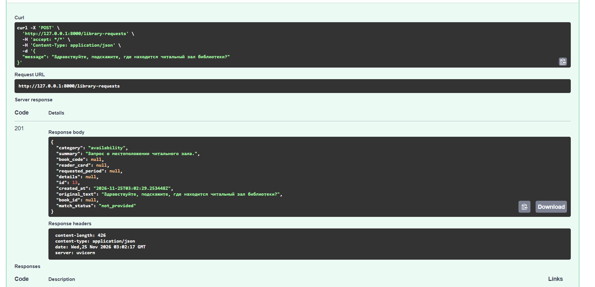

*Рисунок 8 — Правильно оставлены пустые сведения, но категория выбрана неверно.*

### 4.2. Проверка чтения данных

Первый `GET /library-requests` вернул `200 OK` и пустой список `[]`, так как на тот момент записи ещё не были добавлены.

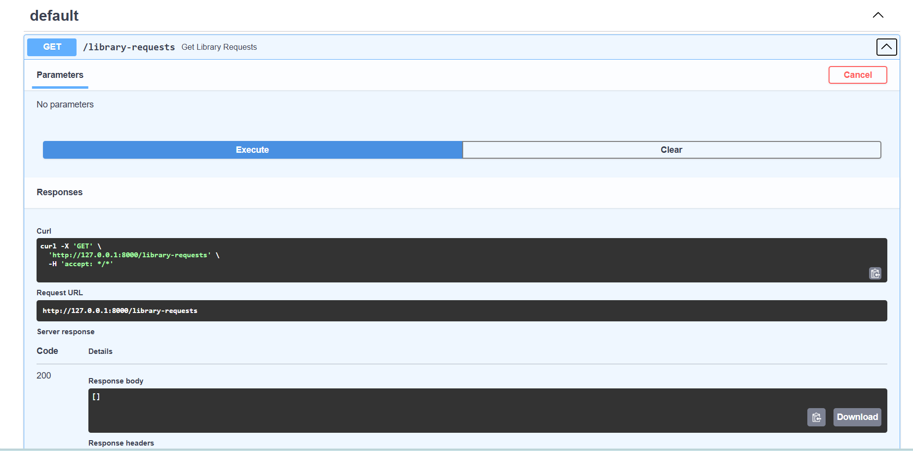

*Рисунок 9 — Получение списка до сохранения обращений.*

После создания обращений я запросила `GET /library-requests/17`: сервер вернул `200 OK` и ранее сохранённые сведения по книге `BK-407`. Для проверки несуществующего ID выполнила `GET /library-requests/9999` и получила `404` с сообщением «Запрос не найден».

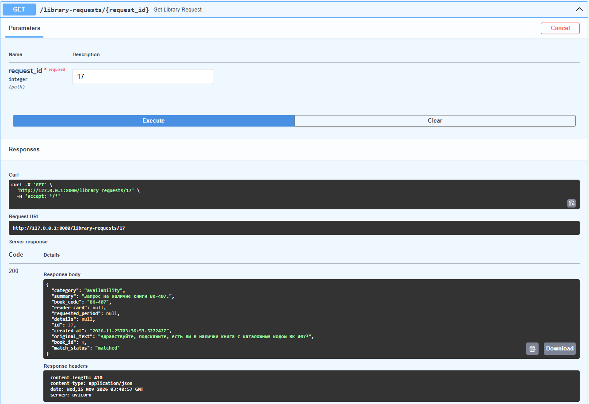

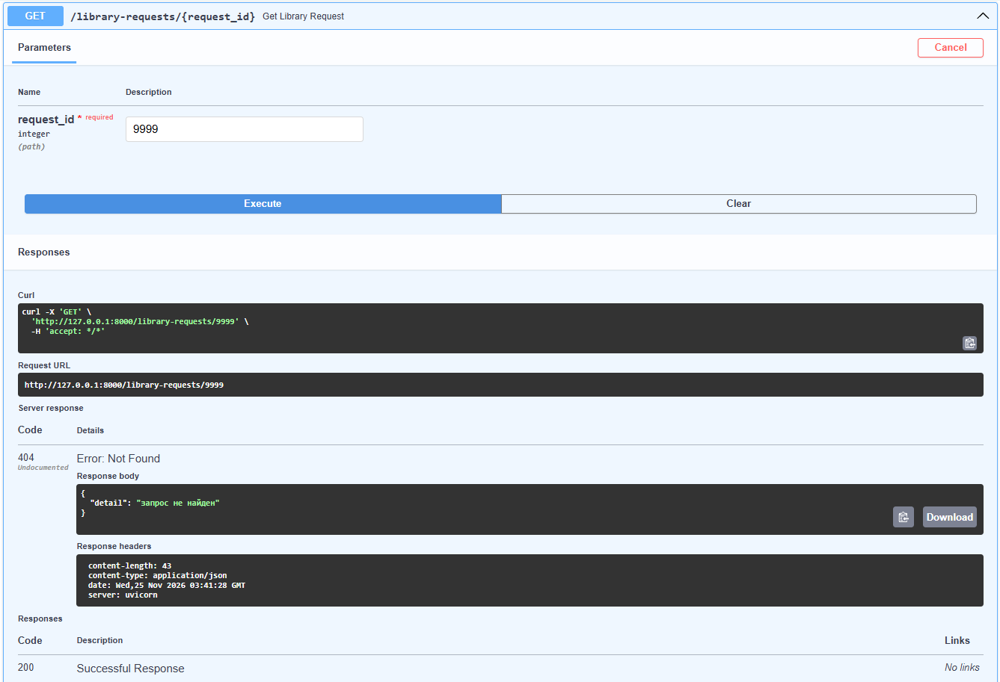

*Рисунки 10–11 — Получение записи по ID и обработка отсутствующей записи.*

### 4.3. Проверка ошибочных ситуаций

Если передать в `message` только пробелы, сервис возвращает `422` с пояснением, что сообщение не должно быть пустым. Если вместо строки отправить число `123`, также возвращается `422`: тип данных не соответствует требованиям.

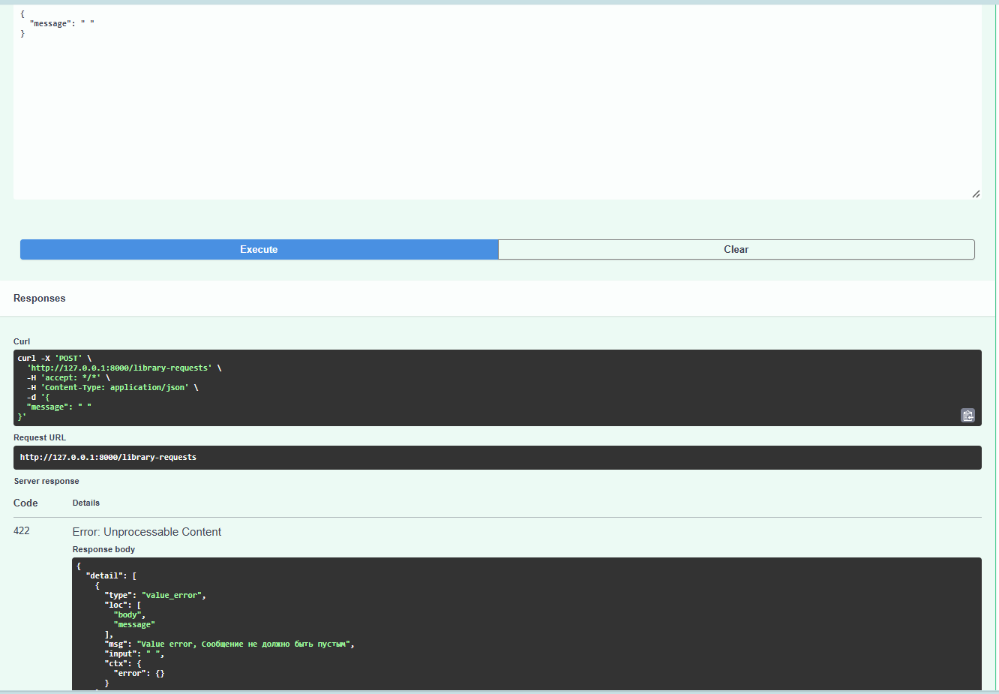

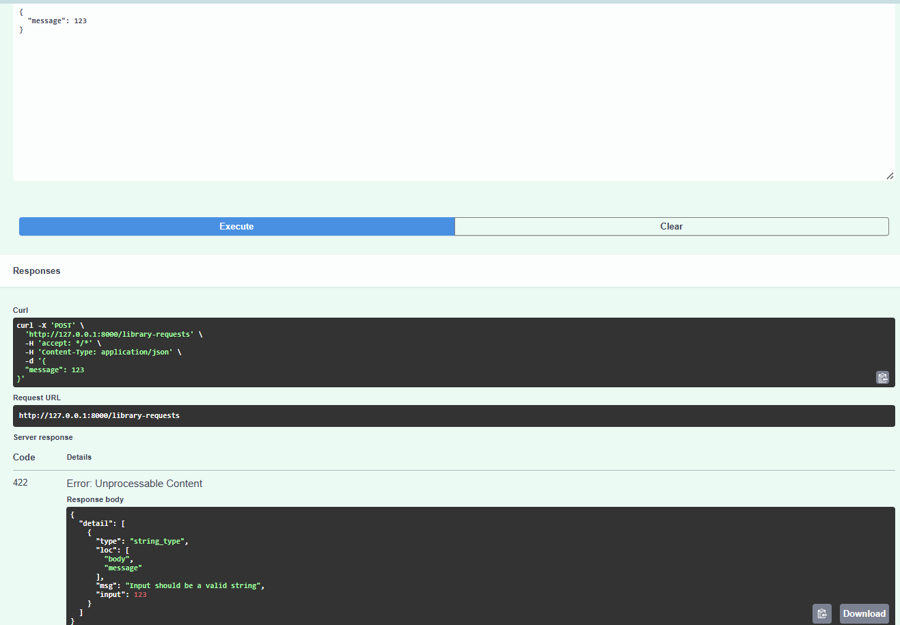

*Рисунки 12–13 — Ошибки проверки входных данных.*

Чтобы проверить недоступность LLM, я остановила сервер LM Studio и отправила запрос на книгу `BK-205`. API вернул **503 Service Unavailable** и понятное сообщение об ошибке подключения.

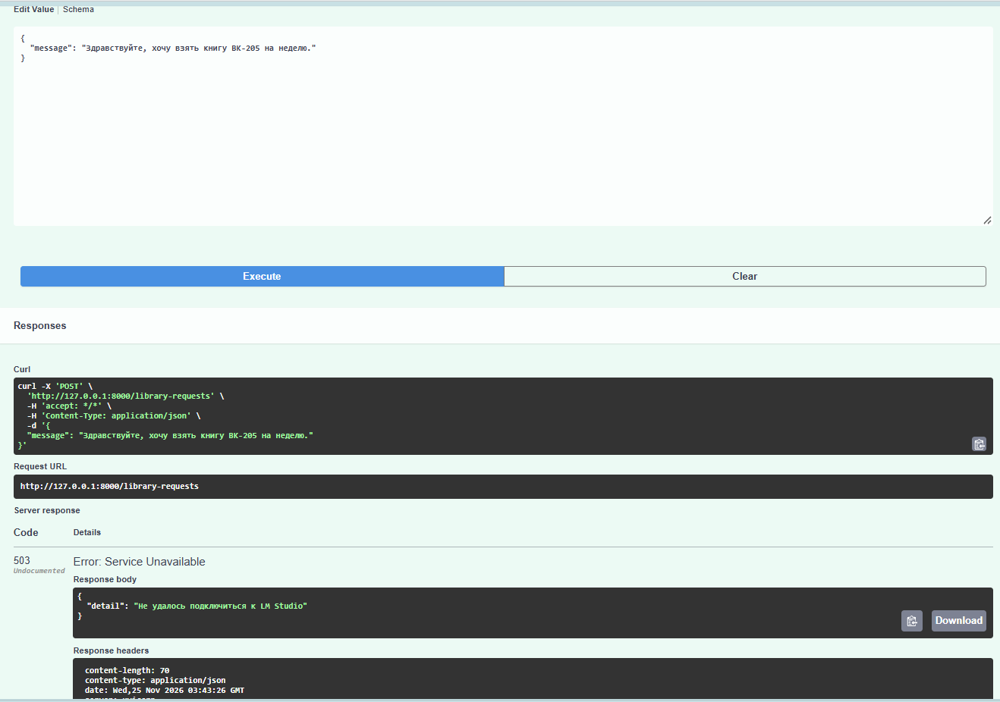

*Рисунок 14 — Ошибка подключения к локальной модели.*

При разработке также наблюдался ответ `502`, когда Qwen возвращала некорректный JSON; после настройки структурированного вывода запросы стали проходить проверку схемы. **Отдельно пока не подтверждены** тайм-аут `504` и отсутствие записи в БД после каждого ошибочного запроса.

## 5. Вывод

Я создала работающий сервис для обработки сообщений читателей: он принимает текст через FastAPI, обращается к локальной Qwen, проверяет JSON, сопоставляет код книги с PostgreSQL и сохраняет данные. Успешно проверены основные маршруты, поиск по известному и неизвестному коду и несколько случаев неправильного ввода.

Главный вывод экспериментов: **правильно сформированный JSON ещё не означает, что модель правильно поняла текст**. В одном опыте она изменила формулировку срока, а в другом ошиблась с категорией. Поэтому для надёжной работы нужны не только проверка схемы, но и контроль смысла извлечённых данных.
